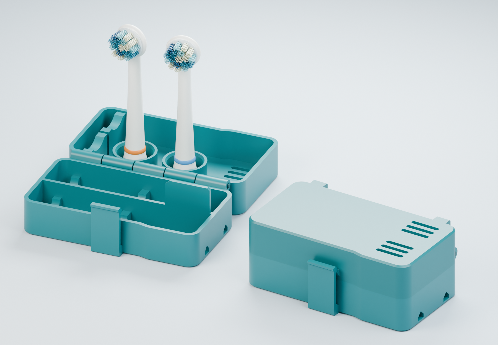

# Headstand

Headstand is a printable travel case for two classic Oral-B round brush heads that share one handle. Pack both heads lengthwise in the divided tray with their bristles up. At the sink, flip the case open flat and move the heads into the two upright sockets in the lid. Water can leave through the side of the case while both halves rest on the counter.

The closed case measures **81.6 × 53.1 × 32.0 mm**, including hinge and latch. It opens to an **81.6 × 97.8 mm** footprint. The sockets tuck into the space above the packed brush shafts.



## Print the fit sample first

Print the [socket sample](exports/Socket-sample.stl) and try both heads, including their colored identification rings. Each should seat under its own weight, lift out easily and stay upright. The default socket has a 15.6 mm opening. The design targets a provisional travel envelope of 74 mm long, 17 mm wide and 22 mm from the back of the head to the bristle tips. Measure your pair before printing the full case. The brush heads in the render illustrate the design.

## Print and assemble

1. Download the [travel tray](exports/Travel-tray.stl) and [stand lid](exports/Stand-lid.stl). Import in millimeters at 100% and print both in the supplied orientations, exterior face on the bed. Start with PETG, a 0.4 mm nozzle, 0.20 mm layers, four walls, 15% infill and supports off.
2. Lay both halves open with their interiors up. Put the vents and the two tray outlets at the same end. Interleave the knuckles and test a straight piece of 1.75 mm filament in the hinge. The knuckles span 71.6 mm.
3. Cut about 75 mm of filament. Form a small mushroom head at one end with a temperature-controlled heat tool, away from the case. Thread the pin back through. Shield the shell while forming the second head. Both heads must be wider than the 2.25 mm bore. Leave roughly 0.3–0.5 mm of end play so the hinge swings freely.
4. Rest the two brush shafts in the tray saddles, with their bristles facing up toward the lid vents. Close gently and check for marks on the bristle bundles. To open, pull the front tab away from the lid and lift.

The three files sliced individually in Bambu Studio 2.8.2.61 using the X1 Carbon 0.4 mm profile, Generic PETG and a textured PEI plate. The estimates include preparation for each separate print.

| Part | Estimated time | Estimated PETG |
| --- | ---: | ---: |
| Socket sample | 24 min | 3.5 g |
| Travel tray | 52 min | 21.4 g |
| Stand lid | 49 min | 20.8 g |

## Edit and verify

Open the [OpenSCAD model](model/Headstand.scad) and use the Customizer to adjust `socket_bore` if the sample is too tight or too loose. Measure the widest part of the bottom 10 mm of both heads. Use the larger measurement plus about 0.6–0.8 mm of total clearance as a starting point for a new sample. Set `part` to `sample`, `tray` or `lid`, render, then export as STL. `open` and `closed` show the assembly.

The [mesh check](scripts/check_meshes.py) exercises the exported default geometry, including a sampled closing sweep with two synthetic brush-head gauges. Run it with Python, NumPy and manifold3d installed. It was developed with NumPy 2.5.3 and manifold3d 3.5.3.

```sh
python3 scripts/check_meshes.py
```

This is a first-print prototype. Actual head fit, wet-counter stability, drainage rate, and hinge and latch durability need a physical trial. Dry the open case before packing where possible. Its drains and vents allow water to escape into a travel bag.
